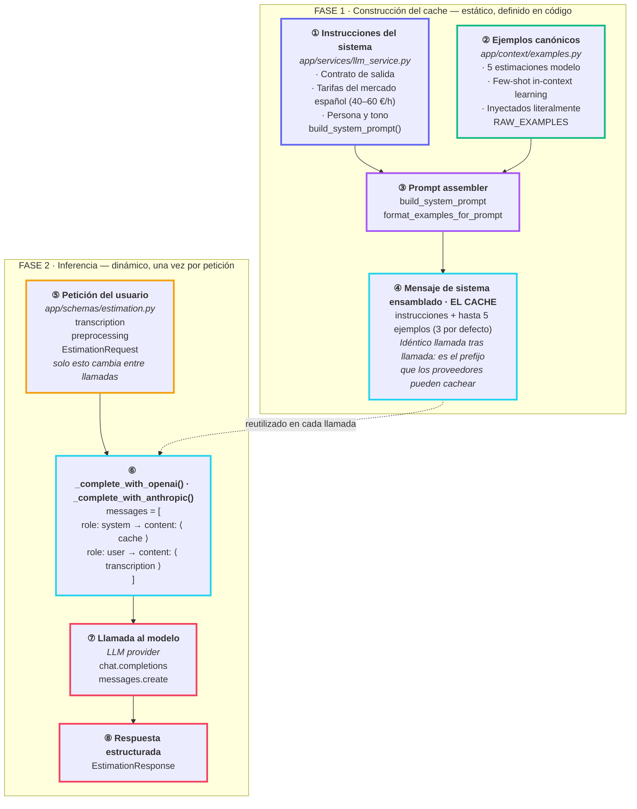
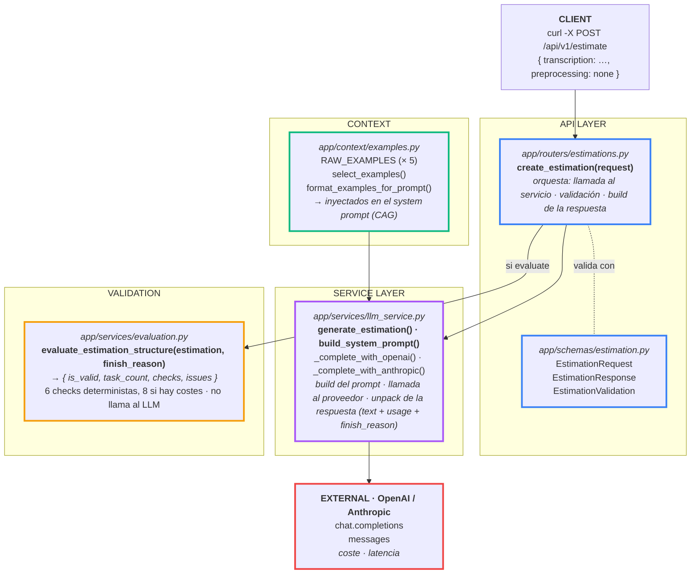

# Estimador CAG

<!-- badges-start -->
[](https://github.com/aelena/lidr-course/actions/workflows/tests.yml) [](https://github.com/aelena/lidr-course/blob/estimador-cag/estimador-cag/pyproject.toml) [](https://www.python.org/) [](https://fastapi.tiangolo.com/) [](https://docs.pytest.org/)
<!-- badges-end -->

Servicio que genera estimaciones de proyectos de software a partir de la transcripción de una reunión con el cliente. Se usa desde una API HTTP o desde una interfaz de chat en el navegador.

Usa **CAG (Cache-Augmented Generation)**: las estimaciones anteriores de la empresa viajan en el prompt de cada llamada al LLM, y el modelo las toma como referencia para calibrar tareas, horas, equipo y duración. No hay base de datos vectorial ni paso de recuperación.

## Características

- Interfaz de chat en Streamlit: se pega la transcripción, la estimación aparece en streaming según la escribe el modelo y se puede seguir preguntando sobre ella.
- Panel lateral de solo lectura con el system prompt, las estimaciones de ejemplo inyectadas y las métricas de la última llamada.
- Endpoint `POST /api/v1/estimate` que recibe una transcripción y devuelve la estimación en markdown.
- Proveedor configurable: OpenAI o Anthropic, elegido con `LLM_PROVIDER`.
- Tres formas de tratar una transcripción con ruido: enviarla tal cual, dar instrucciones de limpieza en el prompt, o extraer antes los requisitos con una primera llamada.
- Validación opcional de cada estimación: estructura, sumas de horas y costes, y respuestas cortadas.
- Generación en streaming desde el servicio (`stream_estimation`), con la conversación completa como entrada.
- Ejemplos de contexto en JSON (`app/context/examples.json`), fáciles de ampliar sin tocar código.
- Configuración validada al arrancar con `pydantic-settings`.
- Documentación interactiva (Swagger) en `/docs`.

## Arquitectura CAG

El "cache" de CAG es el mensaje de sistema: instrucciones y ejemplos definidos en código, que se ensamblan igual en cada llamada.



El mensaje de sistema solo cambia si la petición cambia las opciones que lo construyen (`use_examples`, `num_examples`, `example_format`, `preprocessing`).

Que el proveedor cobre menos por él depende de su tamaño. Medido con `gpt-4o-mini` en llamadas repetidas:

| `num_examples` | Tokens de entrada de la llamada | Tokens servidos desde cache |
|---|---|---|
| `0` | 177 | 0 |
| `3` (por defecto) | 1137 | 1024 |
| `5` | 1845 | 1792 |

OpenAI cachea la entrada a partir de 1024 tokens. Sin ejemplos el mensaje no llega; con los tres por defecto ya lo supera, y a partir de la segunda llamada casi todo el prefijo se sirve desde cache. Con Anthropic habría que marcar además el bloque con `cache_control`, cosa que el servicio no hace.

### Cómo viaja una petición

Ciclo de vida de `POST /api/v1/estimate`:



## Requisitos

- Python 3.14 o superior
- [uv](https://docs.astral.sh/uv/)
- Una API key de OpenAI o de Anthropic

## Instalación

```bash
git clone https://github.com/aelena/lidr-course.git
cd lidr-course/estimador-cag
uv sync
```

## Configuración

Copia la plantilla y rellena la clave del proveedor que vayas a usar:

```bash
cp .env.example .env
```

| Variable | Descripción | Valor por defecto |
|---|---|---|
| `OPENAI_API_KEY` | API key de OpenAI | Sin valor; obligatoria si `LLM_PROVIDER=openai` |
| `ANTHROPIC_API_KEY` | API key de Anthropic | Sin valor; obligatoria si `LLM_PROVIDER=anthropic` |
| `LLM_PROVIDER` | Proveedor a utilizar: `openai` o `anthropic` | `openai` |
| `LLM_MODEL` | Modelo a utilizar | `gpt-4o-mini` |
| `APP_ENV` | Entorno de ejecución | `development` |
| `LOG_LEVEL` | Nivel de logging (`DEBUG`, `INFO`, `WARNING`, `ERROR`, `CRITICAL`) | `DEBUG` |

La aplicación no arranca si falta la clave del proveedor seleccionado. Si cambias a Anthropic, cambia también `LLM_MODEL` (por ejemplo, `claude-haiku-4-5`).

`.env` está en `.gitignore`: las claves no se versionan.

### Secretos de Streamlit

La interfaz de chat acepta además las mismas variables desde [los secretos de Streamlit](https://docs.streamlit.io/develop/concepts/connections/secrets-management), que es donde se configuran al desplegar en Streamlit Community Cloud. En local, crea `.streamlit/secrets.toml`:

```toml
OPENAI_API_KEY = "sk-..."
LLM_PROVIDER = "openai"
LLM_MODEL = "gpt-4o-mini"
```

El orden de preferencia es: variables de entorno, secretos de Streamlit, `.env`. La clave no aparece en el código en ningún caso, y `.streamlit/secrets.toml` también está en `.gitignore`. Si falta la clave del proveedor elegido, la interfaz lo indica en pantalla en lugar del chat.

La API HTTP no lee los secretos de Streamlit: solo el entorno y `.env`.

## Uso

Hay dos formas de usar el estimador: la interfaz de chat y la API HTTP. Son procesos independientes; ninguno necesita al otro.

### Interfaz de chat

```bash
uv run streamlit run streamlit_app.py
```

Se abre en `http://localhost:8501`. Pega la transcripción de la reunión en el cuadro de texto inferior y pulsa Enter (Mayús+Enter añade un salto de línea).

La conversación se guarda en `st.session_state`, así que permanece en pantalla mientras dure la sesión del navegador, y cada pregunta viaja al modelo junto con los turnos anteriores: después de una estimación puedes pedir cambios ("¿y sin la app móvil?") sin volver a pegar la transcripción. Recargar la página empieza una conversación nueva.

La respuesta se muestra en streaming: `st.write_stream` pinta cada fragmento en cuanto el proveedor lo envía, sin esperar a la estimación completa. Con `gpt-4o-mini` el primer fragmento llega en uno o dos segundos y una estimación entera tarda entre siete y diez.

La interfaz llama a `stream_estimation`, del mismo servicio que usa la API, con las opciones por defecto: mismo mensaje de sistema, mismos ejemplos y mismo modelo (`LLM_MODEL`). Si el proveedor falla, el error se muestra en el chat y ese turno no se guarda.

#### Panel lateral

La barra lateral (se pliega con la flecha de su esquina) muestra, sin permitir editar nada:

| Sección | Contenido |
|---|---|
| Última llamada | Modelo y proveedor, tokens de entrada, tokens de salida, tiempo de respuesta total y tiempo hasta el primer token. Se actualiza al terminar cada respuesta |
| System prompt | El mensaje de sistema completo que se envía en cada llamada, tal como lo construye `build_system_prompt()` |
| Contexto estático inyectado | Las estimaciones de `app/context/examples.json` que viajan dentro del system prompt (3 por defecto), cada una con el resumen de su reunión |

Los tokens de entrada crecen con cada turno, porque la conversación entera vuelve a enviarse; el system prompt, en cambio, es idéntico en todas las llamadas. "Nueva conversación" vacía el chat y las métricas.

### API HTTP

Arranca el servidor:

```bash
uv run uvicorn app.main:app --reload
```

La API queda en `http://localhost:8000` y la documentación en `http://localhost:8000/docs`.

### Generar una estimación

```bash
curl -X POST http://localhost:8000/api/v1/estimate \
  -H "Content-Type: application/json" \
  -d '{"transcription": "El cliente necesita una landing page con formulario de contacto y un blog. El plazo ideal es de 4 semanas."}'
```

Respuesta:

```json
{
  "estimation": "## Estimación: Landing Page y Blog ...",
  "model": "gpt-4o-mini",
  "provider": "openai",
  "finish_reason": "stop",
  "total_hours": 130.0,
  "input_tokens": 1013,
  "output_tokens": 122,
  "latency_ms": 3850,
  "extracted_requirements": null,
  "validation": null
}
```

`estimation` es el markdown tal como lo escribe el modelo. `total_hours` no sale del modelo: se suma en código a partir de las tareas del desglose, y es `null` si no se pudo leer ninguna.

Solo `transcription` es obligatorio. El resto de campos del cuerpo ajustan cómo se construye el prompt y cómo se llama al modelo:

| Campo | Descripción | Valor por defecto |
|---|---|---|
| `preprocessing` | Tratamiento de una transcripción con ruido: `none`, `inline_cleaning` o `two_phase` | `none` |
| `use_examples` | Inyecta las estimaciones anteriores; `false` permite comparar sin contexto | `true` |
| `num_examples` | Máximo de estimaciones anteriores a inyectar | `3` |
| `example_format` | Formato de los ejemplos en el prompt: `markdown` o `json` | `markdown` |
| `model` | Modelo a usar en lugar de `LLM_MODEL` | `LLM_MODEL` |
| `max_tokens` | Máximo de tokens que puede generar el modelo | `4096` |
| `thinking_budget` | Tokens de razonamiento para modelos de Anthropic que aceptan presupuesto (por ejemplo, `claude-haiku-4-5`). OpenAI lo ignora | sin razonamiento |
| `evaluate` | Añade a la respuesta, en `validation`, una comprobación de la estructura de la estimación | `false` |

Modos de `preprocessing`:

- `none`: la transcripción se envía tal cual.
- `inline_cleaning`: el prompt de sistema indica al modelo cómo leer una reunión real (ignorar charla informal, resolver contradicciones, interpretar jerga).
- `two_phase`: una primera llamada al LLM convierte la transcripción en una lista de requisitos, que es lo que recibe la llamada de estimación. La lista vuelve en `extracted_requirements`, y los tokens de ambas llamadas se suman.

Con `"evaluate": true`, `validation` indica si la estimación tiene desglose de tareas, total de horas, equipo y duración, si el total que escribió el modelo coincide con la suma de las tareas (y lo mismo con los costes, cuando los hay) y si el modelo terminó sin cortarse. El modelo se equivoca al sumar con cierta frecuencia, y esta comprobación lo detecta.

### Formato de salida

`app/services/llm_service.py` tiene dos instrucciones de salida y una asignación que elige la activa:

- `PROMPT_OUTPUT_BASIC` (activa): pide una estimación sin fijar la estructura, así que el modelo imita la de los ejemplos.
- `PROMPT_OUTPUT_STRUCTURED`: fija resumen, tabla de tareas con horas y coste en EUR, totales, y riesgos y supuestos.

Para cambiarla, edita `ACTIVE_OUTPUT_PROMPT`. ### Tarifas

El prompt de sistema da tarifas de referencia en EUR por hora, sin IVA, y los ejemplos están valorados con las mismas:

| Perfil | EUR/hora |
|---|---|
| Desarrollo | 55 |
| Diseño UI/UX | 45 |
| Testing y QA | 40 |
| Análisis, ingeniería de datos, migración de datos e integraciones con terceros | 60 |

Son una estimación de lo que factura una agencia de software en España, no datos de un estudio de mercado. Para ajustarlas, cambia `RATES` en `app/services/llm_service.py` y el `rate` de las tareas en `app/context/examples.json`; un test comprueba que ambos coinciden.

En Windows, Git Bash y PowerShell pueden enviar los acentos en una codificación que la API rechaza con un 400. Guarda el cuerpo en un archivo UTF-8 y envíalo con `--data-binary "@body.json"`, o usa Swagger.

### Endpoints

| Método | Ruta | Descripción |
|---|---|---|
| `POST` | `/api/v1/estimate` | Genera una estimación a partir de una transcripción |
| `GET` | `/health` | Estado del servicio, entorno, proveedor y modelo |
| `GET` | `/docs` | Documentación Swagger |
| `GET` | `/redoc` | Documentación ReDoc |

Un cuerpo inválido (por ejemplo, una transcripción vacía) devuelve `422`. Un fallo del proveedor de LLM devuelve `500` con el detalle. Una respuesta cortada por `max_tokens` devuelve `200` con `finish_reason` distinto de `stop`.

### Respuesta en streaming

El endpoint HTTP responde de una vez. Para mostrar el texto según lo escribe el modelo, `app/services/llm_service.py` ofrece `stream_estimation`:

```python
from app.services.llm_service import stream_estimation

stream = stream_estimation([{"role": "user", "content": "El cliente necesita..."}])
for delta in stream:
    print(delta, end="", flush=True)

stream.result  # mismas claves que la respuesta del endpoint, más first_token_ms
```

Recibe la conversación completa (mensajes `user` y `assistant` alternados, el último del usuario), de modo que se puede seguir preguntando sobre una estimación. Construye el mismo mensaje de sistema que el endpoint, acepta las mismas opciones (`GenerationOptions`) y no llama al proveedor hasta que se empieza a iterar. `first_token_ms` es el tiempo hasta el primer fragmento; `latency_ms`, el total.

## Estructura del proyecto

```
estimador-cag/
├── app/
│   ├── main.py              # Aplicación FastAPI y endpoint /health
│   ├── config.py            # Configuración desde .env y logging (structlog)
│   ├── routers/
│   │   └── estimations.py   # Endpoint HTTP
│   ├── schemas/
│   │   └── estimation.py    # Schemas de request y response
│   ├── services/
│   │   ├── llm_service.py   # Construcción del prompt y llamada al LLM (completa o en streaming)
│   │   └── evaluation.py    # Validación de la estructura de una estimación
│   └── context/
│       ├── examples.json    # Estimaciones anteriores (datos)
│       └── examples.py      # Carga y renderizado de los ejemplos
├── tests/
├── .env.example
├── streamlit_app.py         # Interfaz de chat (Streamlit)
└── pyproject.toml
```

`routers/` gestiona HTTP, `schemas/` define los contratos de la API, `services/` contiene la lógica de negocio y `context/` guarda los datos estáticos que se inyectan en el prompt.

### Añadir ejemplos de contexto

Añade una entrada a `app/context/examples.json` con `meeting_summary`, `title`, `tasks`, `team` y `duration`. Cada tarea lleva `name`, `hours` y `rate` (EUR por hora del perfil que la hace). El coste de cada tarea y los totales de horas y de coste no se escriben: se calculan a partir de esos dos datos.

Los ejemplos están en `app/` y no en `tests/` porque son datos de ejecución: la aplicación los inyecta en el prompt en cada llamada. Los tests los reutilizan como datos de prueba, pero no son suyos.

## Tests

```bash
uv run pytest
```

Los tests no llaman al LLM: sustituyen el servicio por un doble, así que no necesitan API key ni consumen tokens. La interfaz de chat se prueba con `AppTest`, de Streamlit, sin abrir un navegador.

Hay además un test de evaluación que sí llama al proveedor configurado en `.env`. Solo se ejecuta si se pide:

```bash
RUN_LLM_EVAL=1 uv run pytest
```

## Contribuir

Las contribuciones son bienvenidas:

1. Abre un issue para comentar el cambio que propones.
2. Crea una rama a partir de `main`.
3. Añade tests para el comportamiento nuevo y comprueba que `uv run pytest` pasa.
4. Abre un pull request describiendo el cambio.

## Licencia

Este proyecto todavía no tiene una licencia definida. Hasta que se añada un archivo `LICENSE`, se aplican todos los derechos reservados.
